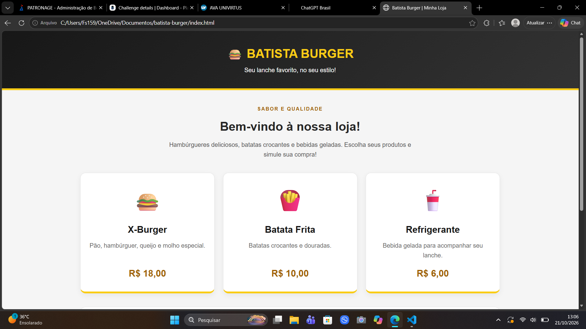

# 🍔 Batista Burger — Simulador de Compras

## 👨‍💻 Informações do projeto

- **Aluno:** Francilene da Silva Batista
- **Trilha:** Desenvolvimento de Mobile
- **Desafio:** Desafio 1 — Minha Loja

## 🏪 Apresentação

A Batista Burger é uma loja fictícia de lanches desenvolvida
para praticar HTML, CSS e JavaScript.

A página permite simular a compra de produtos, informar
quantidades, calcular valores e aplicar desconto.

## 🍟 Produtos e preços

| Produto | Descrição | Preço |
|---|---|---:|
| X-Burger | Pão, hambúrguer, queijo e molho especial | R$ 18,00 |
| Batata Frita | Batatas crocantes e douradas | R$ 10,00 |
| Refrigerante | Bebida gelada | R$ 6,00 |

Compras a partir de R$ 50,00 recebem 10% de desconto.

## 🛠️ Tecnologias

- HTML5
- CSS3
- JavaScript

## ▶️ Como executar

1. Baixe ou clone este repositório.
2. Abra a pasta do projeto.
3. Abra o arquivo `index.html` no navegador.
4. Clique em "Simular compra".
5. Informe as quantidades dos produtos.
6. Confira o resumo da compra.

Não é necessário instalar bibliotecas adicionais.

## 📸 Captura de tela

Depois de tirar uma captura de tela da página, salve-a
na pasta principal com o nome `screenshot.png`.

## 🧪 Testes

Registre os testes depois de executá-los no navegador.

- [ ] Compra sem desconto
- [ ] Compra com desconto
- [ ] Quantidades iguais a zero
- [ ] Produto não selecionado
- [ ] Entrada inválida
- [ ] Conferência dos preços e do total

## 📚 Dificuldade e aprendizado

**Dificuldade encontrada:** [descreva sua dificuldade real.]

**O que aprendi:** Aprendi a criar uma página com HTML,
personalizar a aparência com CSS e usar JavaScript para
receber quantidades, converter valores com Number(),
calcular preços e apresentar resultados com alert().

## 🤖 Uso de inteligência artificial

Utilizei o ChatGPT como apoio para estudar a estrutura
do projeto, organizar os arquivos e compreender a lógica
da simulação de compras.

Adaptei o código para a identidade visual da loja e
verifiquei seu funcionamento por meio de testes no navegador.

## 📌 Objetivo

Projeto acadêmico do Desafio 1 — Minha Loja.
